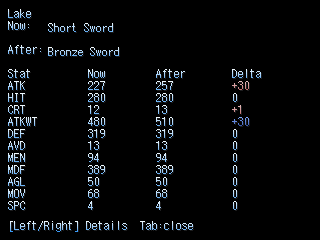
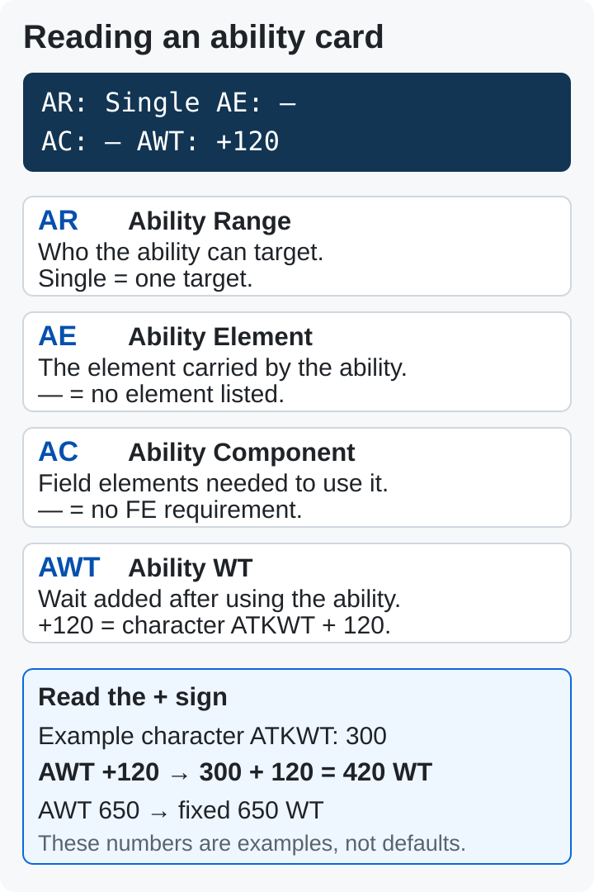
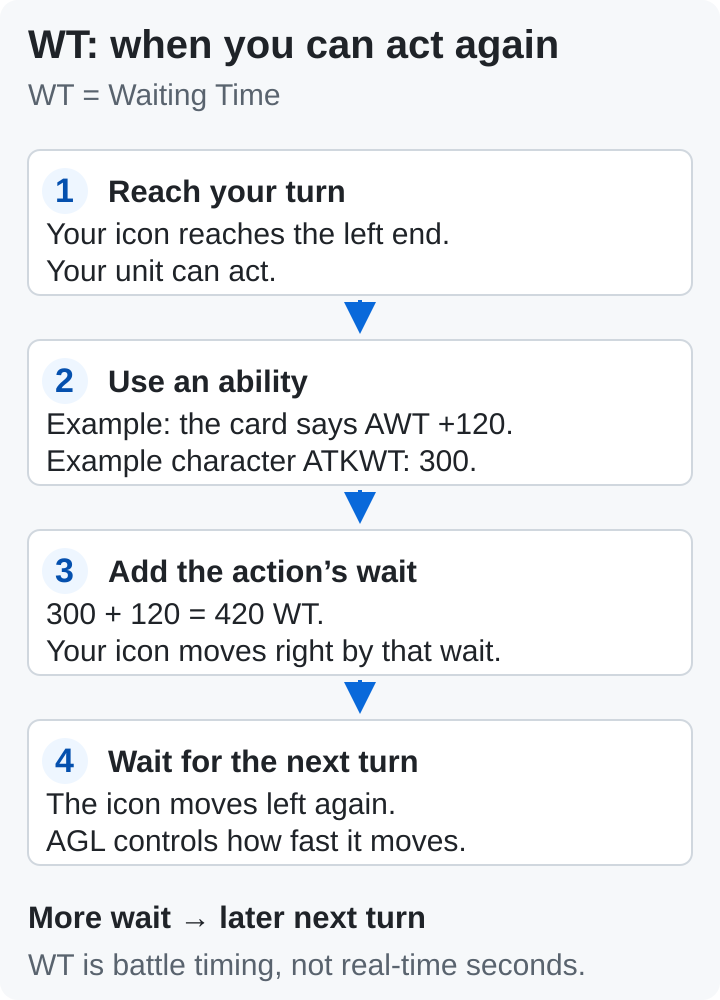

# Seraphic Blue — player guide

[Back to download and start](README.md#downloads)

[Game modes](#modes) · [Altered settings](#arrange) · [Healing](#healing-controls) · [Shop comparison](#shop-compare) · [Battle labels](#battle-labels)

## Choose an Altered mode

Choose a **build** when downloading, then a **mode** when starting an Altered game. DC builds have no mode choice: they use Original-style rules.

| Altered New Game choice | What to expect |
| --- | --- |
| **Extra Content — recommended first play** | Extra maps, chatter, gear and shops. MANY On; BATTLE Off; five ARRANGE switches Off. Weak-enemy skip and the fewer-members EXP bonus start Off. |
| **Original Mode** | Director’s Cut rules plus the fixes listed below, at NORMAL difficulty. MANY and BATTLE Off. |
| **Arrange Mode / Full Arrange** | MANY and BATTLE On, ARRANGE switches On. An option for a second run with Altered’s battle rules. |

**New Game+** with bonus picks is available after clearing, in every mode.

**Full Arrange detail:** the limit is **five of each item per fight**. Full HP recovery is free; TP still uses the **SUP.TP reserve**.

Settings can be changed later in native Config, Config page 3 and MOD → ARRANGE. To reach **DEEP SETTING** (MANY / BATTLE), hold **Shift for about six seconds inside Config**. Free Full HP after battle and reserve-funded HP Auto Fill are independent; both start Off in new Extra Content games. With free healing Off, Supplement shows HP and TP reserves and their Auto Fill controls. [Healing steps](#healing-controls).

Exact settings for each New Game choice

| Setting | Original Mode | Extra Content | Arrange Mode |
| --- | --- | --- | --- |
| MANY (extra content) | Off | On | On |
| BATTLE (Altered battle rules) | Off | Off | On |
| Five ARRANGE switches (MOD menu) | On (no effect while MANY and BATTLE are off) | Off (Original) | On (Altered) |
| Skip Battles with Weak Enemies (Config page 3) | OFF | OFF | ON |
| Character EXP Gain (Config page 3) | ON1 | ON1 | ON2 |
| HP Auto Fill | Off | Off | On |
| TP Auto Fill | Off | Off | On |
| Save from the game menu | Off | On | On |

Original and Full Arrange — rules at a glance

| | Original | Full Arrange (BATTLE + MANY) |
| --- | --- | --- |
| Design | Attrition: the challenge lives between fights | Per-encounter: the challenge lives inside each boss fight |
| HP after a fight | Carries over to the next fight | Full HP after every fight |
| Refills | The SUP.HP / SUP.TP pools refill you and can run dry | Full HP recovery is free; TP still uses the SUP.TP reserve |
| Items | Your buffer, no per-battle limit | 5 of each item per fight |
| Escape | Can fail | Always works |
| Counterattacks | A dice roll | Always fire |
| Ailments on bosses | Bosses resist them | Ailments work on bosses |
| Turn order at the start | Fixed rules | Random opening turn order |
| Gear and shops | As designed | 50 new items, rebuilt shops |

Worked example — one dungeon under Original rules

Same party, same dungeon, same three fights and one boss. This worked example shows both the rules and the decisions they create. No story content. Assumes the MOD's "Escape always works" row is Off (the default on the Altered build since v0.2.1; the DC builds start it On until v0.2.2, so turn it Off in the MOD menu there). This is the Original-style attrition loop. Extra Content starts the five ARRANGE options and HP Auto Fill Off, while retaining Altered’s other changes; see [healing controls](#healing-controls).

1. **You enter the dungeon.** HP is full, the SUP.HP / SUP.TP pools are full (your refill reserve), the bag holds 12 heals.
   - "The pools are my budget for this whole trip. Every point I spend comes out of them."
2. **Fight 1, three weak enemies.** You take 300 damage. After the win, HP stays where it is. If you switched on the game's own Auto Fill option, HP refills and the SUP.HP pool pays for it 1:1 (Auto Fill starts off in both Original and Extra Content modes).
   - "Fine, cheap fight. Refill now from the pool, or carry the damage and save the pool? Pool first, it is early."
3. **Fight 2, a tougher pair.** One enemy inflicts Slow. You weigh curing it or hitting harder.
   - "If I cure, that is an action lost. If I ignore it, I take two more hits. Cure, the boss is still ahead."
4. **Fight 3, an ambush.** You try to escape. The roll fails. You take a round of damage, then it works.
   - "Escape is a dice roll. Burned a turn and 400 HP. The pool will not cover the boss if this keeps up."
### Before and after the boss

5. **Between fights.** The pool is at 30 percent. You check the bag.
   - "Use heals now, or save them for the boss? Turn back to the save tree and refill the pools, or push on?"
   - This is the decision the original game is built around.
6. **Boss.** HP starts wherever you left it. You can throw as many heals as you own. The boss shrugs off your ailment spells; your counterattack sphere triggers now and then, on its roll.
   - "Ailments won't stick on him. It comes down to his elemental weakness, my stats and my heal count. Spam heals, outlast, keep everyone alive."
7. **After the boss.** Pools nearly empty, bag half gone.
   - "Back to a save tree before the next area. I need the refill."

**Result:** the hard part is the journey. You ration a pool across many fights, and the boss is an endurance test you can brute-force with items.

Worked example — the same dungeon under Full Arrange rules

1. **You enter the dungeon.** Full HP, full pools, 12 heals.
   - "HP is not my trip budget here. TP still draws on SUP.TP."
2. **Fight 1, three weak enemies.** You take 300 damage. After the win your HP is full again; the pool is untouched.
   - "HP refills for free; any TP I spend still uses its reserve."
3. **Fight 2, a tougher pair.** Slow lands on you. Your counterattack sphere now triggers whenever it is allowed to, not on a roll; crits land on more moves.
   - "Cure or hit? Hitting is better here, my counters are doing half the work."
4. **Fight 3, an ambush.** You pick Escape. It works whenever escape is allowed at all.
   - "Not worth fighting. Gone."
### Before and after the boss

5. **Between fights.** HP is full; check the TP reserve before the boss.
   - "Enough SUP.TP left? Then straight to the boss."
6. **Boss.** You start at full HP. You may use at most 5 of each item in this fight. Ailments now work on the boss; the chain and break gauges reward attacking in rhythm.
   - "Five of each healing item, so each use must be timed. Can I Slow him? Yes. Break gauge is at 60 percent, two more hits and his guard drops. Pattern, not endurance."
7. **After the boss.** Full HP again.
   - "On to the next area."

**Result:** this example puts more pressure on each boss and the limit of five of each item per fight. Full HP recovery is free; TP still uses the SUP.TP reserve, as the comparison table states.

**With the five ARRANGE switches Off** in Extra Content, the example uses the Original-style HP/item/escape/counter rules above while keeping the extra maps, gear and shops. The remaining Arrange formula changes (crit rules, the Charge command, guard math, stat coefficients) stay on; they change numbers, not this flow.

## About DC Altered

**Seraphic Blue (DC Altered Version) Ver2.13** is an unofficial Director’s Cut fan patch by **腐林檎** (Rotten Apple) and **時空転移プリン** (Space-Time Warp Pudding, ◆YuikkIDGis). **Tempura (Sakaki) was not involved.** The authors ask players not to contact Sakaki or the Blue Field boards about Altered.

**Included:** the whole game in English (Altered's new text translated, its Japanese picture text redrawn in English), the MOD menu, the Original-mode choices below, and the standard RPG Maker files the game expects (so no separate runtime install is needed). EasyRPG Player is included and required: the database has 8,040 variables and picture ids up to 78, which the old RPG_RT.exe cannot run (it is not included).

**New Altered game, or an existing Altered save from v0.2.0 onward.** Keep DC saves on the EN + MOD (DC) build (v0.3.9; earlier DC saves load there). The ZIP extracts to its own **SeraphicBlue-Altered** folder; read **IMPORTANT README (MUST READ).txt** first.

## Altered contributors

Credits from the included Japanese Altered manual (**ManualAlt**, **改造版マニュアル.htm**):

| Contribution | Credit |
| --- | --- |
| Music | 氷石彩亜 (FREEDOM HOUSE 2nd), 星野春日 (Muzie), 煉獄小僧 (煉獄庭園), Ciel (Le Ciel Bleu) |
| Sound effects | WEB WAVE LIB |
| Backgrounds | aska (Silverry moon light) |
| Battle-animation graphics | Character Maker Pro (Enterbrain) |
| Help | 2ch Blue Field threads and 風邪薬 ◆RohTo3cNBI |

[Full original credits](CREDITS.md) · [MOD credits and contact](README.md#help)

## ARRANGE switches

Each row is **On (Altered)** or **Off (Original)**. The default is On in Arrange Mode; the Extra Content choice starts them Off. The HP and counter rows use **MANY or BATTLE**. The item-limit and extra escape-rule rows use **MANY**. The enemy row controls selected MANY/shared changes. With both native modes off, these overrides have no effect. These five switches restore the listed rule groups; Altered’s other fixes and native BATTLE mechanics remain. The enemy-stat option does not turn BATTLE off; Extra Content keeps BATTLE off separately.

| Switch | On (Altered, default) | Off (Original) |
| --- | --- | --- |
| Full HP after battle | Free full-HP recovery after battle | Free recovery is disabled. Separate HP Auto Fill can still spend SUP.HP to refill HP |
| Item limit per battle | At most 5 of each item in a battle (20 when the item limit is lifted); the rest returns after the battle | No per-battle limit |
| Escape always succeeds | Escaping works whenever escape is allowed | The original escape roll (the MOD's own "Escape always works" row still applies) |
| Counterattack always fires | A counterattack always triggers when it can | The original counter chance |
| Enemy stats and resistances | Altered's enemy data | The original enemy data (enemies that are new in Altered keep theirs) |

- **With BATTLE on, the Escape and Enemy rows follow BATTLE's own rules.**
- **Not switchable through these five MOD switches** (retained in Arrange mode): critical hits, Charge, guard, pre-emptive odds, low-difficulty areas, Quick/Slow and Clever/Forgetful checks, value caps, HP/TP display, level-learned abilities, sphere duplicate bonus, stat coefficients, battle result multipliers, full-heal bottles, revive heals survivors, single-target hit roll, village patterns. Altered's own Config can switch off the random turn order, the luck elements and the timing hits.

## Change healing on an existing save

**Two separate healing settings.** **Full HP after battle** provides free recovery. **HP Auto Fill** spends one point of **SUP.HP** for each HP restored and stops when the reserve runs out. Both start **Off** in new Extra Content games (introduced before this release). Existing saves keep their settings.

1. To disable free recovery, open **Escape > MOD > Confirm**, change to **ARRANGE**, and set **Full HP after battle: Off (Original)**.
2. Open **Supplement**. With free recovery Off, both **SUP.HP** and **SUP.TP** are visible. Press **Shift** to select the Auto Fill controls, select **HP**, then press **Confirm** to toggle it.
3. **Auto Fill Short Notice** in native Config only changes the announcement. It does not enable or disable healing.

**TP is separate:** abilities spend TP; TP Auto Fill draws from SUP.TP when enabled. Supplement level-ups raise capacity without refilling the current reserve. Rest/refill sources replenish reserves. The earlier MANY screen hid HP controls; the repaired screen shows them whenever free healing is Off. Turning healing Off does not increase monster stats: native **BATTLE** and **Enemy stats and resistances** control different rules.

**Loaded saves keep their own settings.** Choosing Extra Content for a new game does not change a save you load. You can change the MOD ARRANGE switches on an existing save; a new game is not required.

- **+ marks gear that exists only in Altered's extra content.**
- **Altered saves from v0.2.0 onward load in v0.3.9.** Extract the new game to a new folder and copy the old **saves** and **config** folders into it. Keep the new **EasyRPG.ini**. Existing ARRANGE choices stay as they were. Only older saves that have never initialized these five switches receive their all-On starting values; that does not overwrite an already configured save.

Original Mode — Director’s Cut plus these fixes

- Opposite buffs and debuffs resolve sanely (for example a speed-up on a slowed unit cancels instead of failing).
- Enemy phase changes are measured as a share of max HP (a DC oversight where an enemy had extra HP).
- Overflow safety for extreme numbers (damage calculation order, caps of 300 on HIT / CRT / AVD / AGL / MOV).
- Reflex Guard halves damage once, as in DC (Altered halved it twice in Original mode).
### Mode defaults and remaining corrections

- Sickness, five boss rewards and the key-item money bonus are back to their DC rules in Original mode (Arrange keeps Altered's).
- A new game started as **Original Mode** begins with Config > "Skip Battles with Weak Enemies" OFF, "Auto Fill" OFF and "Character EXP Gain" without the fewer-members bonus, and Config "Default" resets the first and the third to match. A new game started as **Arrange Mode** begins with all three ON, as Altered does. The separate **Extra Content** choice keeps weak-enemy skip and the fewer-members EXP bonus OFF; its HP Auto Fill starts OFF.
- Clever on a Forgetful unit still gives x1.3 as in DC (the Altered manual says x1.0; the game data says x1.3).

Altered menu differences and display notes

| MOD row | On the Altered build |
| --- | --- |
| Walk speed, Hold Shift to run | Use Config > Dash Movement (page 1). Shift is the dash modifier for both native dash modes and keeps click-to-walk active. Stationary Shift retains native secondary actions. |
| Battle speed | Not in the MOD menu: use Config > Battle Speed (page 3; FAST2 also skips skippable effects) |
| Menu fade | Not in the MOD menu: use Config > Screen Speed of Menus (page 2) |
| Save anywhere (cheat) | Not in the MOD menu: use Config > Normal Save Method: MENU (page 1) |
| MOD button | Menu slot 9. With Save Method MENU, slot 9 asks Save / MOD / Break |
| ARRANGE page (v0.2.1) | Altered build only: [the five ARRANGE switches](#arrange). Pages: SPEED, BATTLE, ARRANGE, CHEATS, INFO |
| Random-battle intro, Cutscene speed, Text speed, Text pauses, Random battles 1/N, Rewards follow the rate, Escape always works, Retry lost battles, Full heal, Return to world map, +10,000 DEAR, Level up party, early MOD access | As on the DC build. Retry also gives back the items Arrange's per-fight limit held back. In Arrange mode, Full heal does not revive KO members (Altered's own heal rule); in Original mode it does. |

- **Steps Left** (Altered Config, Arrange Mode panel) counts the MOD encounter rate: at 1/2 it shows twice the steps. The display only has a hundreds digit of 1 or 2, so a count of 300 or more shows as 2xx, and with random battles Off it shows a 2 followed by the last two digits of a very large number.
- **Menu hover (v0.3.4):** Move the pointer to highlight a menu choice or inspect its help. Hover does not confirm, buy, equip, apply a setting or move the player. Click or press Enter to choose. Keyboard/gamepad navigation takes control until the pointer moves again. Unavailable choices keep their native restrictions.
- **Battle mouse on the Altered build (v0.3.1):** command grid, enemy targets with hover, ability and item rows with hover, page change by mouse wheel, category tabs, ally targets.
- **Battle timeline:** DC and Altered show full participant names. Altered uses its own battle layout and keeps its DRIVE/red marker variants. DC keeps its native battle panel. Click-to-walk, mouse controls, message history and fast-forward are enabled.
- **Database naming note:** the original README reports that one party member’s name uses this translation’s chosen spelling instead of the 2016 data’s spelling in Altered, while EN + MOD (DC) retains the 2016 spelling. That note does not identify the character. The [v0.3.1 history](README-HISTORY.md#v031) separately records the spelling Yancy; these notes do not establish that they refer to the same character.

## Compare equipment before buying

**English builds: highlight a weapon or frame, then press Tab or click [Tab] Compare.** The new panel shows the selected character’s **Now / After / Delta** totals for all 11 stats. Opening it does not buy, sell or equip anything.

1. Highlight the weapon or frame in the shop. The native bottom-left colors still mean **red = improvement**, **blue = worse**.
2. Press **Tab** or click **[Tab] Compare**. Read the numerical changes. **Lower ATKWT is better.** Hidden item data stays hidden.
3. Press **Left / Right** for details, including sphere slots a lower-capacity frame would remove. **Up / Down** pages an unusually long item-name card.
4. Press **Tab**, **Cancel**, or **right-click** to close. Use the native **Shift** hint to change character after closing. Confirm still opens the purchase quantity screen separately.

The new panel is for **English shop weapons and frames**. Spheres need a specific replacement slot, so they do not have a direct shop comparison. The **Equipment** screen already shows numerical totals with a selected character and slot. Inventory items have no selected comparison character. The Japanese build keeps its native preview.

## Battle labels — spoiler-free

Start with this example ability card: **AR: Single · AE: — · AC: — · AWT: +120**. The labels describe its target, element, field requirement and delay. The ability list’s separate number is its **TP cost**.

| Ability-card label | Meaning |
| --- | --- |
| **AR — Ability Range** | **Single** = one target; **All** = the whole target side. A single/all ability lets you switch with Up/Down while choosing its target. |
| **AE — Ability Element** | The ability’s element; using it shifts **FE** toward that element. **—** means no ability element is listed. |
| **AC — Ability Component** | The **field element needed to activate** it. That FE is used up toward neutral. **—** means no FE requirement; the ability may still cost TP. |
| **AWT — Ability WT** | Wait added **after** acting. **+120** means **ATKWT + 120**. A plain number such as **650** means a fixed **650 WT**. |

**When can I act again?** **WT** means **Waiting Time**. Icons move left on the battle timeline; a unit acts at the left end, then moves right by its action’s WT. More wait means a later next turn. **WT is not seconds.**

| Timing label | Read it as |
| --- | --- |
| **WT — Waiting Time** | Remaining wait until the unit can act. |
| **ATKWT — Attack Waiting Time** | The character’s normal physical attack delay. Example: ATKWT **300** and AWT **+120** give **420 WT** after the ability. |
| **AGL — Agility** | How fast the unit’s WT decreases. |
| **MOV — Moving** | Affects starting WT, preemptive/surprise chances, escape and reactions. It is separate from AGL. |

| Resource / field label | Meaning |
| --- | --- |
| **HP** | Health, shown as current / maximum. At zero the unit is incapacitated. |
| **TP — Technical Points** | Spent to use abilities. Check the listed cost before choosing one. |
| **FE — Field Element** | Elements currently present on the battlefield. AE changes them; some abilities need an AC element already present. |
| **SPC — Sphere Capacity** | How many spheres the character can equip. |

| Common stat labels | Meaning |
| --- | --- |
| **ATK / DEF** | Physical attack / physical defense. |
| **MEN / MDF** | Mental ability power / mental defense. |
| **HIT / AVD** | Physical hit / avoidance ratings. They affect hit chance; a rating is not itself a guaranteed hit percentage. |
| **CRT** | Critical-hit rating for normal physical attacks. |

**Element codes on Status:** **Fi / Wa** = Fire / Water; **Wi / Ea** = Wind / Earth; **Li / Da** = Light / Dark; **He / Br** = Heaven / Break. Element offense and resistance describe how strongly an element affects damage, not a chance to inflict it.

These definitions follow Tempura’s included Playing Manual: **Abilities**, **Battle: Overview / Mechanics / Actions**, and **Status**. Altered can change individual abilities and battle rules; read the actual card’s numbers.

English menu labels and retained artwork

Menu labels are pictures with a fixed width. Where the full English did not fit in the game font, the label uses a code or a narrower font instead of a shortened word. The same list ships in the ZIPs as **MENU-LABEL-NOTES.txt**.

- **Poison** is written in full across two lines, **Poi / son**, in the Status screen's 16 px tile. Trigger and defense values stay aligned, including 100%.
- **Two-letter element codes** on the Status screen: Fi Wa Wi Ea Li Da He Br.
- **Narrower font, full English kept:** Attack Magic and Support Magic (Abilities screen), Qty to Make (Extend screen), Discount and Qty to Sell (shop screen); in the Altered build also Paralysis, Ailment Trigger Rate / Defense Rate and Support Magic Lv (Status screen); two long dictionary titles.
- **MOV** (DC EN Status screen) = the movement stat ("Moving"); the 2016 label said "DEX". "Field Mutation Element" replaces the 2016 label "Element Physical Cast".
- **Spoiler file (Altered ZIP):** **HIDDEN-DICTIONARY-ENTRIES (SPOILERS).txt** holds 3 unreachable dictionary entries written for an unfinished sequel. Read it only after finishing the game.

