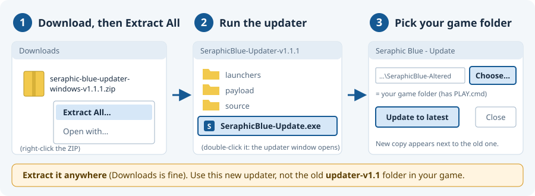

<a name="start"></a>


# Seraphic Blue MOD

An English retranslation of **Seraphic Blue**, Tempura’s 2004 RPG Maker 2000 game. Includes mouse controls, message history, speed settings, fewer random battles and optional cheats. You can also play the **DC Altered** fan patch in English.

**v0.3.9** · Complete game downloads · Windows and Linux Players included

Final reviewed English wording fixes. Includes the bundled GUI updater; the existing game interface is retained.

> [!IMPORTANT]
> **Updating on Windows? Get the fixed updater first: [download updater v1.1.1](https://github.com/Nostramadeus/seraphic-blue-mod/releases/download/v0.3.9/seraphic-blue-updater-windows-v1.1.1.zip).**
> The updater inside your game folder (**updater-v1.1**) has a bug. It downloads the update, then stops with *"Update stopped: The property 'Text' cannot be found on this object."* Your old game and saves are not changed when this happens.
>
> 1. Download the ZIP above. Right-click it → **Extract All**. Any place works, Downloads is fine.
> 2. In File Explorer, open the extracted **SeraphicBlue-Updater-v1.1.1** folder and double-click **SeraphicBlue-Update.exe**. The updater window opens.
> 3. In the updater window, click **Choose…** and select your game folder (the one with **PLAY.cmd**). Then click **Update to latest**.
>
> Did the old updater fail for you? It left a **.sb-update-download-…** folder next to your game folder. You can delete it. Prefer doing it by hand? Use the [manual update](#manual-update).



[Download & start](#downloads) · [Controls](#controls) · [Update](#keep-your-saves) · [Player guide](PLAYER-GUIDE.md) · [Help & credits](#help)

<a name="downloads"></a>
## Download and start

**First time playing? [Download English + MOD + Altered — v0.3.9](https://github.com/Nostramadeus/seraphic-blue-mod/releases/download/v0.3.9/seraphic-blue-fullgame-EN-Altered-v0.3.9.zip).**


1. Download the ZIP above. No original game, patching or extra runtime download is needed.
2. Right-click the ZIP → **Extract All**. Open **SeraphicBlue-Altered** and keep its files together.
3. **Windows:** double-click **PLAY.cmd**. **Linux:** open a terminal in that folder and run **sh play-linux.sh**.
4. Choose **New Game → Extra Content (Recommended)**.

That choice keeps Altered’s extra maps, chatter, gear and shops with Original-style battle settings: **MANY On · BATTLE Off · all five ARRANGE switches Off**. Free **Full HP after battle** and reserve-funded **HP Auto Fill** both start **Off**. You can change these later; loading an existing save keeps that save’s settings.


**Continuing an older game, or playing in Japanese?** Choose the matching edition:

| Download | Use it for |
| --- | --- |
| **[English + MOD + Altered](https://github.com/Nostramadeus/seraphic-blue-mod/releases/download/v0.3.9/seraphic-blue-fullgame-EN-Altered-v0.3.9.zip)** | DC Altered Ver2.13 in English. A new game, or an Altered save from v0.2.0 onward. |
| **[English + MOD (DC)](https://github.com/Nostramadeus/seraphic-blue-mod/releases/download/v0.3.9/seraphic-blue-fullgame-EN-v0.3.9.zip)** | Director’s Cut. Keeps DC saves from earlier tests, the 2016 English patch and the Japanese original. |
| **[Japanese + MOD (DC)](https://github.com/Nostramadeus/seraphic-blue-mod/releases/download/v0.3.9/seraphic-blue-fullgame-JP-v0.3.9.zip)** | Japanese Director’s Cut with a Japanese MOD menu. |

All three downloads are **v0.3.9**. Each ZIP contains the full game, Windows and native Linux Players **0.8.1.1-sb7**, and launchers. DC builds use Original-style rules and have no mode choice. **DC saves do not transfer to Altered.**

[All downloads](https://github.com/Nostramadeus/seraphic-blue-mod/releases) · [Compare the three Altered modes](PLAYER-GUIDE.md#modes) · [Detailed installation](INSTALL.md)

<a name="platform-setup"></a>
## Choose your platform

<details open><summary>Platform setup and limits</summary>

| Platform | Open or run | Support |
| --- | --- | --- |
| **Windows** | Double-click **PLAY.cmd**. [Windows guide](WINDOWS.md) | Included custom controls. |
| **Native Linux** | Run **sh play-linux.sh**. [Linux requirements](LINUX.md#native-linux-player) | Current custom controls; tested headlessly in Linux containers. Physical desktop and Deck drivers unverified. |
| **Linux through Proton** | Add **Player.exe** to Steam and enable Proton. **Start In:** game folder. **Launch Options:** blank. [Linux guide](LINUX.md) | Includes mouse features; Proton compatibility not verified here. |
| **Steam Deck** | Desktop Mode: use **play-linux.sh**, or **Player.exe** through Proton. For Proton, **Start In:** game folder; **Launch Options:** blank. [Deck guide](STEAM-DECK.md) | Includes mouse features; physical Deck hardware not tested here. |
| **macOS — experimental** | Official Mac EasyRPG Player with this ZIP’s game data. [Mac instructions](#macos-experimental-keyboard-route) | Custom Player features unavailable; untested on Mac. |

**Already have a working Steam shortcut? Keep its paths.** The old `--save-path saves` option fails if that folder does not exist. Direct **Player.exe** shortcuts bypass the launcher that creates it, and may save **SaveNN.lsd** beside Player.exe. Changing the save path later can hide existing saves from the load menu. [Details](STEAM-DECK.md#windows-player-through-proton).

The **v0.3.9 ZIPs include empty saves and config folders**. Blank Launch Options remain the recommended Proton setup.

</details>

<a name="choose-altered-mode"></a>
## Choose an Altered mode


In the Altered edition, choose **Extra Content** for a first play, **Original Mode** for Director’s Cut rules, or **Arrange Mode** for Altered’s battle rules. These are New Game choices, separate from the three download editions above.


**Full Arrange detail:** the limit is **five of each item per fight**. Full HP recovery is free; TP still uses the **SUP.TP reserve**.

[Full mode comparison and settings](PLAYER-GUIDE.md#modes) · [View the diagram full size](docs/img/mode-picker.svg)

<a name="controls"></a>
## Controls


<details open><summary>Keyboard, mouse and controller shortcuts</summary>

| Action | Keyboard | Mouse |
| --- | --- | --- |
| Move or select | **Arrow keys** | Hover a supported row; click ground to walk. |
| Confirm | **Enter** | **Left-click**. Hover only previews. |
| Back / cancel walking | **Escape**; arrows also cancel walking | **Right-click**. |
| Secondary action / MOD page | **Shift**, following the screen’s hint | Follow the displayed hint; Shift still needs a key or button. |

### Pages, history and fast-forward

| Action | Controls |
| --- | --- |
| Battle spell or item page | **Left / Right**, mouse wheel, or click the page arrows. |
| Status / Gear / Ability tabs | **Page Up / Page Down**, or click a top tab. Left / Right still changes character. |
| Message history — last 100 boxes | **Page Up** or mouse wheel **up** while a message shows or while walking. Scroll with Up / Down or the wheel; page with Page Up / Down; close with Escape or right-click. It includes your chosen answers, clears on load/new game, and is not saved. |
| Fast-forward | Hold  **F** for **3×** or  **G** for **10×**. Both speeds are adjustable in **Settings → Input**. Controller: right trigger. |

### More menu shortcuts

| Task | Mouse | Keyboard |
| --- | --- | --- |
| Buy or sell several items | Click **−10 / −1 / +1 / +10**, then **Buy/Sell**. | Arrows adjust the quantity; Enter confirms. |
| Supplement or Upgrade amounts | Hover a digit/amount; wheel adjusts; click **Apply/Upgrade**. | Arrows select/adjust; Enter confirms. |
| Dictionary and history | Hover supported rows; wheel changes list pages or scrolls history. | Arrows navigate; Enter chooses where applicable. |

Native name-entry and number-entry keep their original keyboard controls. Keyboard/gamepad selection keeps control until the pointer moves again.

**Steam Input:** D-pad → arrows; A / B / X → Enter / Escape / Shift; optional LB / RB → Page Up / Page Down. Use the [suggested bindings](STEAM-DECK.md#suggested-steam-input-controls). They are not a bundled or verified Deck preset. Touch cannot hover before contact.

**Need a visual example?** See [Quick tutorials](#quick-tutorials), [shop comparison](#shop-compare), or the [battle-label guide](#battle-labels).

</details>

<a name="keep-your-saves"></a>
## Update and keep your saves


**Keep DC saves on DC. Keep Altered saves on Altered.** Altered saves from v0.2.0 onward load in v0.3.9. DC also accepts saves from the Japanese original, the 2016 patch and earlier MOD tests.

### Included updater

> [!IMPORTANT]
> **Windows: use [updater v1.1.1](https://github.com/Nostramadeus/seraphic-blue-mod/releases/download/v0.3.9/seraphic-blue-updater-windows-v1.1.1.zip).** The **updater-v1.1** folder inside v0.3.9 and older games fails after downloading ("The property 'Text' cannot be found on this object"). Extract v1.1.1 anywhere, double-click its **SeraphicBlue-Update.exe**, then choose your game folder in the window that opens. [Step-by-step picture](#start).

| Platform | What to click |
| --- | --- |
| **[Windows updater v1.1.1](https://github.com/Nostramadeus/seraphic-blue-mod/releases/download/v0.3.9/seraphic-blue-updater-windows-v1.1.1.zip)** | Extract it anywhere → open **SeraphicBlue-Updater-v1.1.1** → **SeraphicBlue-Update.exe** → **Choose** your old game folder → **Update to latest**. Optional **Enable startup checks** checks when you launch **PLAY.cmd**. |
| **[Linux startup updater v1.1](https://github.com/Nostramadeus/seraphic-blue-mod/releases/download/v0.3.7/seraphic-blue-updater-linux-v1.1.0.zip)** | Open the included **updater-v1.1** folder → **Startup-settings.desktop** → select your game folder → **Enable startup checks**. Launch **play-linux.sh** to check. There is no separate Linux **Update now** button. Requires Python 3 and zenity or kdialog. |

The updater checks free space, verifies the download and copied saves/settings/Auto recordings, and installs into a **neighboring version folder**. It keeps the old game and a verified backup, and preserves the new **EasyRPG.ini**. Startup checks offer **Install update** or **Play current**; offline checks and check errors continue the current game. You can disable checks in the setup tool.

The updater is included in every v0.3.9 game ZIP; the separate downloads above are only needed for older installs. Keep its complete folder together. Direct **Player.exe** / **native-linux/Player** shortcuts skip startup checks. Steam shortcuts are not changed automatically: point them at the desired version’s launcher if you want checks. Existing working Proton shortcuts can stay as they are. [Updater instructions and limits](updater-v1.1/README.md).

<a name="manual-update"></a>
### Manual update — four steps

1. Close the game. Back up its **saves** and **config** folders, plus any **SaveNN.lsd** files beside Player.exe.
2. [Download the same edition](#downloads) and extract it into a **new folder**.
3. Copy your **saves** and **config** folders into the new copy. Keep the **new EasyRPG.ini** so current controls and label tables stay enabled. Copy any loose **SaveXX.lsd** files into the new **saves** folder. Also copy **sb-repeat-a.json** and **sb-repeat-b.json** if they sit beside Player.exe; files already inside **saves** come with that folder.
4. Start the new copy and load your usual save before removing the old one.

The included launchers store saves in **saves** inside the extracted game folder. A custom `--save-path` or direct Player shortcut may use another location: copy from the location you actually used. [Full migration instructions](INSTALL.md#update-and-keep-saves) · [Archived test-release patches](README-HISTORY.md#old-updates).

<a name="whats-new"></a>
## What is new in v0.3.9

**Saved battle commands:** win manually, then press **R** at the start of a matching encounter. The idle on-screen button starts hidden; enable **F1 → Engine → Show Auto button** if wanted. The update also includes four English wording corrections (three matching Altered passages) and one directly translated **DC-only** picture card.

The experimental modern UI remains unfinished and is **not included**. The additional translation review is separate and incomplete. This release does not claim a full playthrough or a complete new translation audit.

<details><summary>Auto / R — how recording, replay and stopping work</summary>

Available only in the **English DC and Altered builds** on Windows and native Linux. It is unavailable in the Japanese profile and the stock Mac Player.
1. Win a supported encounter entirely manually. The game remembers the latest such victory for that enemy group and ordered party.
2. At the start of the same encounter, press **R** before your first action. If you enabled the optional button, clicking **Auto** also starts it. It executes the saved commands, using the normal battle rules.
3. Choose **Auto**, press **R**, or press **Cancel** to stop. The current committed action can finish. Auto cannot restart during that fight.
4. An illegal command, missing item, insufficient TP, changed target or exhausted recording stops Auto with a short message. Finish manually. This repeats commands; it does not plan new actions or guarantee victory.

If no usable manual victory is saved, the button explains why it cannot start. A fight using Auto does not replace the manual recording. Automatic, forced or unsupported command sequences are not recorded as a new fully manual victory.

**Show Auto button** is an engine preference under **F1 → Engine** and starts **Off**. F1 opens EasyRPG settings, where display preferences are saved separately from your game save. Cheats remain under **Esc → MOD → CHEATS**. When On, both English builds show the same clickable **[R] Auto** control at the upper right. **[R] Stop** appears during replay even when the idle button is hidden. **R** always works. The visible button also works with the mouse. Steam Input can map **R** to a chosen button, including a back button; physical Steam Deck controls have not been tested here. Existing fast-forward controls are unchanged.

Auto recordings are separate from game saves. The GUI updater v1.1 preserves them. For a manual update, copy the matching **saves** folder; if **sb-repeat-a.json** or **sb-repeat-b.json** is beside **Player.exe**, copy those files to the new matching edition too.

</details>

[Current release notes](RELEASE-NOTES.md) · [Historical changes](README-HISTORY.md#release-history) · [Tested limits](COMPATIBILITY.md)

### Display preferences — F1

While playing, press **F1 → Engine**. These display settings are in EasyRPG's settings screen; they are not rows in **Esc → MOD**. Both start **Off** and are saved separately from your game save.

| Setting | What you see when enabled |
| --- | --- |
| **Song title banner** | A brief song-name banner after the music changes during field exploration. It hides during dialogue, menus, battles and transitions. It does not stay on every screen. |
| **Show Auto button** | The idle **[R] Auto** button in supported English DC/Altered battles. **R** works while hidden; **[R] Stop** still appears during replay. |

On Steam Deck, Steam Input can map F1 to a chosen button; these physical bindings have not been tested here. Optional cheats remain under **Esc → MOD → CHEATS**.

<a name="quick-tutorials"></a>
## Quick tutorials


<details open><summary>Five ways to move through the game</summary>

**Use the included Player for these controls:** Windows, native Linux, or Windows through Proton. Deck buttons assume the [suggested Steam Input bindings](STEAM-DECK.md#suggested-steam-input-controls), not a bundled preset.

<table>
<tr>
<td width="55%" valign="top">
<b>Select menus, spells and targets</b>
<ul>
<li><b>Mouse:</b> hover to preview;  left-click to choose. Works on supported menu rows, enemies and allies. In battle this covers both builds (the Altered battle screen since v0.3.1).</li>
<li><b>Keyboard / Deck:</b>     arrows / D-pad select;  / A confirms;  / B backs out.</li>
<li><b>Result:</b> highlight and information update. Hover spends nothing. A stationary mouse leaves keyboard selection alone.</li>
</ul>
</td>
<td valign="top"></td>
</tr>
<tr>
<td width="55%" valign="top">
<b>Find the next spell or item page</b>
<ul>
<li><b>Mouse:</b>  wheel or  click the page arrows; hover an entry to select it.</li>
<li><b>Keyboard / Deck:</b> Left/Right / D-pad left/right changes pages; Up/Down selects a row.</li>
<li><b>Result:</b> <b>&lt; 2/3 &gt;</b> means page two of three. Applies to paged battle magic/items and supported menu lists.</li>
</ul>
</td>
<td valign="top"></td>
</tr>
<tr>
<td width="55%" valign="top">
<b>Switch Status / Gear / Ability without backing out</b>
<ul>
<li><b>Mouse:</b>  click a top tab. <b>Keyboard:</b> Page Up / Page Down. <b>Deck:</b> bind LB / RB to those keys.</li>
<li><b>Result:</b> switch screens while keeping the same character. Left/Right still changes characters.</li>
<li>Tabs work at the top level; back out of an unfinished selection first. Reserve characters cannot open Ability.</li>
</ul>
</td>
<td valign="top"></td>
</tr>
<tr>
<td width="55%" valign="top">
<b>Click or tap to walk</b>
<ul>
<li><b>Mouse:</b>  click ground to route there;  click an NPC's feet to approach and interact once.</li>
<li><b>See:</b> white square = hovered tile; green square = accepted destination. No green square means no route was accepted. It clears on arrival or cancellation.</li>
<li><b>Cancel / walk manually:</b>     arrows / Deck D-pad.  / B or  right-click also cancels routing. No separate keyboard destination picker.</li>
<li><b>Deck touchscreen:</b> tapping ground is expected to work through Proton because <a href="https://partner.steamgames.com/doc/steamhardware/steamdeck/faq#Input">Deck taps normally act as mouse clicks</a>. <b>Not tested on Deck hardware.</b> If tapping fails, try the right trackpad as Mouse + left-click. Hover preview needs a trackpad/mouse.</li>
</ul>
</td>
<td valign="top"></td>
</tr>
</table>

**Advance dialogue and story pauses**

- **Mouse:**  left-click. **Keyboard / Deck:**  / A with the suggested binding.
- Press while text appears to reveal it faster; press again at a dialogue pause to continue. Use separate presses, not a held click.
- **Not every pause is skippable:** timed scene waits, movement and animations can continue. Use **MOD → SPEED → Cutscene speed** to shorten scripted waits; confirm is not a universal scene-skip button.
- **Choice guard (v0.3.1):** for a third of a second a choice window ignores Enter that is held down or pressed repeatedly, so the Skip prompts are not skipped by accident. Cancel works at once.

</details>

<a name="mod-menu"></a>
## MOD menu and native Config


<details open><summary>Open the menu, change settings, and use optional cheats</summary>

**Two menus:** Press **Escape** to open the game menu, select **MOD**, then use the key below.

| While MOD is selected | What opens |
| --- | --- |
| **Enter / Confirm** | **Our MOD menu**, in every build. In Altered, if Config > Normal Save Method is **MENU**, choose **MOD** from the **Save / MOD / Break** prompt. |
| **Shift** | **Native Config, page 1** — **Altered build only**. This shortcut works from any normal main-menu slot. For the native **DEEP SETTING** panel (MANY / BATTLE), hold Shift about six seconds **inside Config**. |

The DC builds have no Altered Config screen. **Inside our MOD menu**, Shift changes the MOD page. **Inside native Config**, Shift + Confirm or Cancel opens **Change settings all at once**: use the current mode’s defaults, match the unmodified game’s settings, or Cancel. Shift + Down jumps to the last row; Shift + Up jumps to the first. These bulk resets affect **native Config**, not the complete Extra Content preset or the MOD menu’s choices.

**Open:**  / Deck B → select **MOD** →  / A. Before the story unlocks the game menu,  / Deck B opens the MOD screen directly (no CHEATS page yet). **Navigate:**  / X changes page; / selects a row; / changes its value.  / A confirms actions. Settings apply immediately and stay with your save. Choose **INFO** for the in-game explanations. The Altered build adds an **ARRANGE** page ([full ARRANGE guide](PLAYER-GUIDE.md#arrange)).

### Movement and transitions

| Setting | Try / result |
| --- | --- |
| Walk speed / Hold Shift to run | Choose 2x for faster walking. Enable running; hold  / X to run. Scripted movement stays unchanged. |
| Battle speed | Choose 2x–10x for shorter waits/animations; Instant skips animation waits. |
| Random-battle intro | Off skips the random-battle flash; story intros stay. |
| Menu fade | Choose 0.1 s or None for quicker menu transitions. |

### Story and text speed

| Setting | Try / result |
| --- | --- |
| Cutscene speed | Choose 2x/5x/Instant to shorten scripted waits. This changes scene pacing. |
| Text speed | Choose 2x, 4x or Instant to show message text faster (1x = normal). |
| Text pauses | Choose 2x or 4x to shorten the pauses inside messages (1x = normal). Pauses are shortened, never removed. |

**Altered:** use native Config for Dash Movement (page 1), Battle Speed (page 3), menu fade (page 2), and Normal Save Method (page 1). These replace the equivalent MOD rows. [All Altered differences](PLAYER-GUIDE.md#altered-menu).

### BATTLE — choose how often you fight

| Setting | Try / result |
| --- | --- |
| Random battles | Choose 1/2–1/10 for fewer fights, or Off for none. |
| Rewards follow the rate | On scales EXP, DEAR and SUP.EXP to compensate for fewer automatic NORMAL random fights. Manually requested Shift fights in native FREE mode give ordinary rewards. The engine caps each reward at 999,999 per fight, so at 1/10 in the late game a scaled reward can be trimmed. |
| Escape always works | On guarantees escape from random battles; story battles stay unchanged. |
| Retry lost battles | On offers a retry after defeat. **Items spent in the lost fight stay spent.** |

### CHEATS — optional actions

Enable the CHEATS page when asked. Select an action and confirm. **Save first before teleporting or saving during an event.**

| Action | Result |
| --- | --- |
| Full heal | Restores party HP and TP. |
| Return to world map | Returns to your known world-map position; can skip events. Visit the world map first. |
| Save anywhere | Opens saving here; unusual save locations can interrupt events. |
| +10,000 DEAR | Adds 10,000 currency. |
| Level up party | Raises every party member by one level. |

</details>

<a name="altered-build-en--mod--altered"></a>
## More help while playing

**Altered modes and settings:** [compare Original, Extra Content and Full Arrange](PLAYER-GUIDE.md#modes), or read [what the Altered fan patch changes](PLAYER-GUIDE.md#altered).

<a name="healing-controls"></a>
**Healing:** free **Full HP after battle** and reserve-funded **HP Auto Fill** are separate. Both start Off in new Extra Content games. [Change healing on an existing save](PLAYER-GUIDE.md#healing-controls).

<a name="shop-compare"></a>
**Shop comparison:** in an English build, highlight a weapon or frame and press **Tab** or click **[Tab] Compare**. Read **Now / After / Delta** for all 11 stats. Opening it buys and equips nothing. **+** before a gear name marks Altered extra-content equipment. [Illustrated shop guide](PLAYER-GUIDE.md#shop-compare).

<a name="battle-labels"></a>
**Battle labels:** [illustrated, spoiler-free guide to AR / AE / AC / AWT, WT, HP / TP and common stats](PLAYER-GUIDE.md#battle-labels).

<a name="help"></a>
## Help and credits


**Bug reports and questions:** [GitHub Issues](https://github.com/Nostramadeus/seraphic-blue-mod/issues) · **Contact:** [afrotankrob@gmail.com](mailto:afrotankrob@gmail.com)

| Project | Creators |
| --- | --- |
| **Seraphic Blue** | **Tempura (Sakaki)** — original game, released freely in 2004. |
| **2016 English translation** | **eplipswich** and the original translation/proofreading team. |
| **DC Altered Version** | **腐林檎** (Rotten Apple) and **時空転移プリン** (Space-Time Warp Pudding, ◆YuikkIDGis). |
| **This MOD and retranslation** | **Nostramadeus**. |

Thank you to the original creators and translators for making this project possible. Tempura was not involved in Altered; please do not contact Sakaki or the Blue Field boards about the fan patch.

[Full original credits](CREDITS.md) · [Altered contributors and included manual](PLAYER-GUIDE.md#altered-credits) · [Licenses](LICENSES.md) · [Corresponding source](SOURCE-ACCESS.md)

<a name="translation-notes"></a>
<details><summary>Translation comparison and retained Japanese material</summary>

**Compare the translations:** the [side-by-side page](https://nostramadeus.github.io/seraphic-blue-mod/) shows Japanese, 2016 English, this English, and explanations for several hundred dialogue boxes. It also has a section on lines the 2016 patch softened. **It quotes the whole game.** Sections are gated by story part; avoid it if you want no story spoilers. [Early-game corrections](EARLY-GAME-CORRECTIONS.html) starts with the opening and Episode 2; later sections stay hidden until selected.

The project retranslated every dialogue box from Japanese. The separate additional meaning review is still incomplete; it is not a new whole-script accuracy guarantee.

The English DC manual is mostly the 2016 English translation; **four pages are Japanese and two are mixed**. Altered’s manual and update history are Japanese. Some status labels retain an English word with a Japanese gloss. Character reading captions, original artist-name credits and small background/sprite lettering remain as artwork. The English game content and original manuals/credits are included; this is not a claim that every image and manual page is English.

[Menu-label notes](PLAYER-GUIDE.md#menu-labels) · [Review scope and tested limits](COMPATIBILITY.md) · [Historical release notes](README-HISTORY.md#release-history)

</details>

<a name="source-questions"></a>
<details><summary>Known source questions — unresolved, with story spoilers hidden</summary>

- **Recap wording, Map 27:** the original Japanese leaves the person requesting help unstated. The current English follows one plausible reading. A wider source search did not settle it, so the wording is retained as an unresolved context question, not a confirmed translation error.
- **Missing Map 550 reference:** an old event points to a map file absent from the checked original Japanese releases. The checked normal scene uses another route. No player-triggerable failure has been demonstrated, and no authentic replacement file was found.
- **Missing Map 824 reference:** a reference to another absent map appears in an event labelled “discarded draft.” The checked normal scene uses a different exit. No player-triggerable failure or authentic replacement file has been established.

<details><summary>One story reply — spoilers; chapter information hidden</summary>

<details><summary>Reveal chapter information (spoiler)</summary>

The exact chapter is not established for this stored dialogue fragment. A related page's episode condition is not enough to date this fragment, so no chapter number is assigned here.

</details>

<details><summary>Reveal the passage and decision (story spoilers)</summary>

The Japanese reply **何が分かると？** remains **“Understand what?”** in English. It returns to an earlier “I understand” claim after an argument about the speaker's credibility. The stored fragment does not establish exactly what is understood, which can make the question feel disconnected even in Japanese.

The source event is labelled “dialogue stock.” This does not by itself prove that every route leaves it unused. The current English preserves the source's elliptical reply; no extra explanation or stronger accusation has been added. This wording is retained unless new source evidence changes the reading.

</details>

</details>

These original-source questions are parked. No substitute maps or speculative script changes have been added. Reconsider them if a reproducible gameplay failure or authentic new source appears.

</details>

<a name="macos-experimental-keyboard-route"></a>
<details><summary>macOS — experimental keyboard setup</summary>

Use the latest game-data MOD with the **official Mac EasyRPG Player**. A custom Mac Player is not included.

1. [Download the full game](https://github.com/Nostramadeus/seraphic-blue-mod/releases/download/v0.3.9/seraphic-blue-fullgame-EN-v0.3.9.zip) and extract it. Keep the **SeraphicBlue** folder together.
2. Install [Homebrew](https://brew.sh/) if needed. In Terminal, run:

```sh
brew install easyrpg-player
```

3. In Terminal, type `cd ` (including the space), drag the extracted **SeraphicBlue** folder into Terminal, and press . Run:

```sh
mkdir -p saves config
easyrpg-player --project-path . --save-path saves --config-path config --encoding 932 --window
```

**Controls:**     arrows select/move;  confirms;  goes back;  runs/opens secondary actions. Saves go in **SeraphicBlue/saves**.

**Limits:** script-based MOD options are expected to work. Custom hover/click targeting, click-to-walk, character tabs, enhanced text reveal and battle-animation acceleration need our modified Player and are unavailable here. **This Mac route is untested.** [Official Mac support](https://easyrpg.org/player/downloads/) · [Homebrew package](https://formulae.brew.sh/formula/easyrpg-player.html).

</details>

<a name="project-reference"></a>
<details><summary>Release history, source and modding</summary>

[README release history and archived update steps](README-HISTORY.md) · [Full release notes](RELEASE-NOTES.md) · [Changelog](CHANGELOG.md)

[Modding notes](https://github.com/Nostramadeus/seraphic-blue-mod/blob/main/docs/MODDING-NOTES.md) cover Altered integration problems, how they were found, fixes and the working build order. Documentation images are script-generated: [generators](docs/img/tools), [image licenses](docs/img/LICENSES.md).

[Player source and library replacement](SOURCE-ACCESS.md) · [Advanced installation](INSTALL.md) · [Compatibility and tested limits](COMPATIBILITY.md)

</details>
