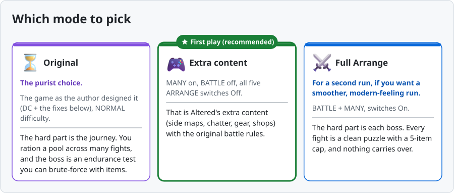
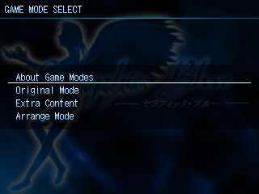
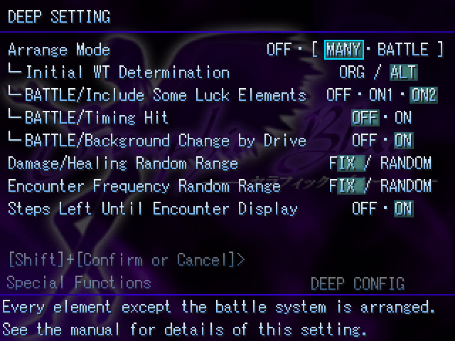
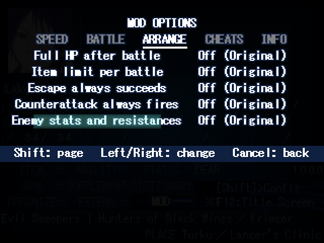
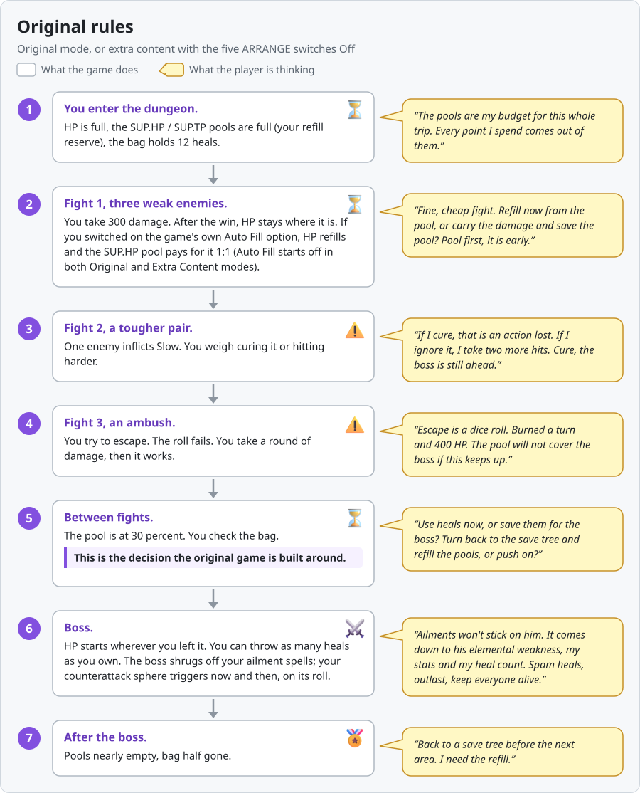
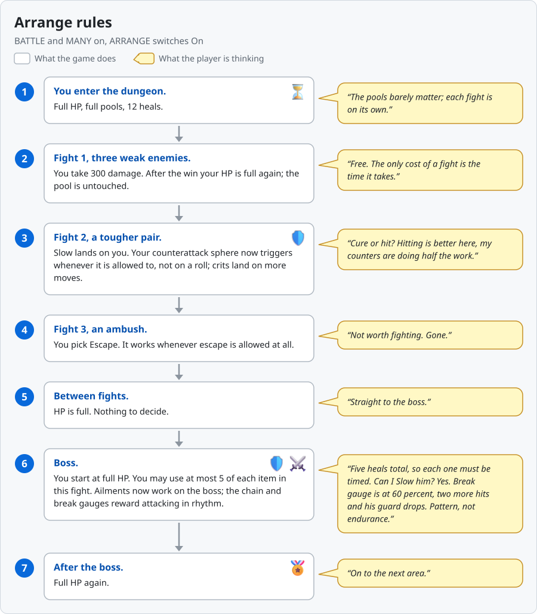
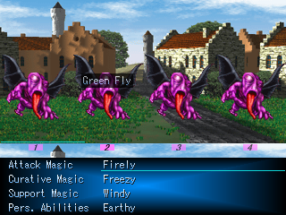
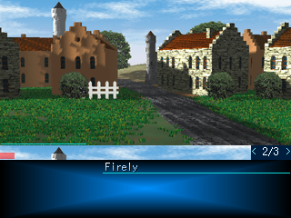
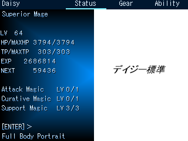
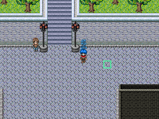

*Seraphic Blue* (Tempura, 2004, RPG Maker 2000), in English again: every dialogue box retranslated from the Japanese, a MOD menu (fewer random battles, speed, cheats, message history, mouse play), and an optional English build of the *DC Altered* fan patch. One ZIP per build; no original game, patching or extra downloads needed.

**Status:** released. Current version: v0.3.1 for all three builds. Bug reports and questions: [Issues](https://github.com/Nostramadeus/seraphic-blue-mod/issues).


**Which mode to pick.** Two separate choices: first the **build** (which ZIP you download), then the **mode** (Altered build only). The three bullets below are builds. They are not the three mode cards further down.

- **New player:** the **EN + MOD + Altered** build. Then New Game > **Extra Content** (the middle card below: MANY on, BATTLE off, all five ARRANGE switches Off). All the extra content with the original battle rules.
- **Already have saves** (a test release, the 2016 English patch or the Japanese original): the **EN + MOD (DC)** build. Your saves load as they are. No mode choice: a DC build always plays like **Original**.
- **Playing in Japanese:** the **JP + MOD (DC)** build. No mode choice: it always plays like **Original**.

**Then pick your mode (Altered build only).** Three modes, shown below: **Original**, **Extra content** (first play, recommended) and **Full Arrange**. The DC builds have no mode choice.



- **Extra content = first play (recommended): MANY on, BATTLE off, all five ARRANGE switches Off.** That is Altered's extra content (side maps, chatter, gear, shops) with the original battle rules.

**New Game > Extra Content (Recommended).** That is the whole setup. The choice itself turns MANY on, keeps BATTLE off, sets the five ARRANGE switches to Off (Original) and starts the weak-enemy skip and the fewer-members EXP bonus off, like Original. Everything stays changeable later: Config (hold  Shift about six seconds for the hidden DEEP SETTING panel: MANY / BATTLE), Config page 3, and the MOD menu's ARRANGE page. TP Auto Fill is in the Supplement screen; HP Auto Fill is always on while MANY is on, which is how the HP pool refills you after a fight.



<details><summary><b>Open: what each New Game choice sets</b></summary>

| Setting | Original Mode | Extra Content | Arrange Mode |
| --- | --- | --- | --- |
| MANY (extra content) | Off | On | On |
| BATTLE (Altered battle rules) | Off | Off | On |
| Five ARRANGE switches (MOD menu) | On (no effect while MANY and BATTLE are off) | Off (Original) | On (Altered) |
| Skip Battles with Weak Enemies (Config page 3) | OFF | OFF | ON |
| Character EXP Gain (Config page 3) | ON1 | ON1 | ON2 |
| HP Auto Fill | Off | On | On |
| TP Auto Fill | Off | Off | On |
| Save from the game menu | Off | On | On |





</details>
- **Original: the purist choice.** The game as the author designed it (DC + the fixes listed under the Altered build), NORMAL difficulty.
- **Full Arrange (BATTLE + MANY, switches On): for a second run**, if you want a smoother, modern-feeling run.
- New Game+ with bonus picks is available after clearing, in every mode.

**Still not sure which to pick?** Compare the two gameplay loops below: first a table at a glance, then the same dungeon trip twice, once under Original rules and once under Arrange rules. Click **Open** on each line to expand it.

<details><summary><b>Open: Original vs Full Arrange at a glance (table)</b></summary>

| | Original | Full Arrange (BATTLE + MANY) |
| --- | --- | --- |
| Design | Attrition: the challenge lives between fights | Per-encounter: the challenge lives inside each boss fight |
| HP after a fight | Carries over to the next fight | Full HP after every fight |
| Refills | The SUP.HP / SUP.TP pools refill you and can run dry | Not needed between fights |
| Items | Your buffer, no per-battle limit | 5 of each item per fight |
| Escape | Can fail | Always works |
| Counterattacks | A dice roll | Always fire |
| Ailments on bosses | Bosses resist them | Ailments work on bosses |
| Turn order at the start | Fixed rules | Random opening turn order |
| Gear and shops | As designed | 50 new items, rebuilt shops |

</details>


<details><summary><b>Open: A dungeon trip, Original rules: the seven steps as a diagram and as text</b></summary>

Same party, same dungeon, same three fights and one boss. Each step: what the game does, then what the player is thinking. No story content. Assumes the MOD's "Escape always works" row is Off (the default on the Altered build since v0.2.1; the DC builds start it On until v0.2.2, so turn it Off in the MOD menu there). These rules apply in Original mode, and in the extra-content mode with the five ARRANGE switches Off.



1. **You enter the dungeon.** HP is full, the SUP.HP / SUP.TP pools are full (your refill reserve), the bag holds 12 heals.
   - "The pools are my budget for this whole trip. Every point I spend comes out of them."
2. **Fight 1, three weak enemies.** You take 300 damage. After the win, HP stays where it is. If you switched on the game's own Auto Fill option, HP refills and the SUP.HP pool pays for it 1:1 (Auto Fill is off at new game in Original mode; on in extra-content mode).
   - "Fine, cheap fight. Refill now from the pool, or carry the damage and save the pool? Pool first, it is early."
3. **Fight 2, a tougher pair.** One enemy inflicts Slow. You weigh curing it or hitting harder.
   - "If I cure, that is an action lost. If I ignore it, I take two more hits. Cure, the boss is still ahead."
4. **Fight 3, an ambush.** You try to escape. The roll fails. You take a round of damage, then it works.
   - "Escape is a dice roll. Burned a turn and 400 HP. The pool will not cover the boss if this keeps up."
5. **Between fights.** The pool is at 30 percent. You check the bag.
   - "Use heals now, or save them for the boss? Turn back to the save tree and refill the pools, or push on?"
   - This is the decision the original game is built around.
6. **Boss.** HP starts wherever you left it. You can throw as many heals as you own. The boss shrugs off your ailment spells; your counterattack sphere triggers now and then, on its roll.
   - "Ailments won't stick on him. It comes down to his elemental weakness, my stats and my heal count. Spam heals, outlast, keep everyone alive."
7. **After the boss.** Pools nearly empty, bag half gone.
   - "Back to a save tree before the next area. I need the refill."

**One line:** the hard part is the journey. You ration a pool across many fights, and the boss is an endurance test you can brute-force with items.

</details>


<details><summary><b>Open: A dungeon trip, Arrange rules: the same trip with BATTLE and MANY on, ARRANGE switches On</b></summary>



1. **You enter the dungeon.** Full HP, full pools, 12 heals.
   - "The pools barely matter; each fight is on its own."
2. **Fight 1, three weak enemies.** You take 300 damage. After the win your HP is full again; the pool is untouched.
   - "Free. The only cost of a fight is the time it takes."
3. **Fight 2, a tougher pair.** Slow lands on you. Your counterattack sphere now triggers whenever it is allowed to, not on a roll; crits land on more moves.
   - "Cure or hit? Hitting is better here, my counters are doing half the work."
4. **Fight 3, an ambush.** You pick Escape. It works whenever escape is allowed at all.
   - "Not worth fighting. Gone."
5. **Between fights.** HP is full. Nothing to decide.
   - "Straight to the boss."
6. **Boss.** You start at full HP. You may use at most 5 of each item in this fight. Ailments now work on the boss; the chain and break gauges reward attacking in rhythm.
   - "Five heals total, so each one must be timed. Can I Slow him? Yes. Break gauge is at 60 percent, two more hits and his guard drops. Pattern, not endurance."
7. **After the boss.** Full HP again.
   - "On to the next area."

**One line:** the hard part is each boss. Every fight is a clean puzzle with a 5-item cap, and nothing carries over.

**With the five ARRANGE switches Off** in the extra-content mode, you get the Original trip above while keeping the extra maps, gear and shops. The remaining Arrange formula changes (crit rules, the Charge command, guard math, stat coefficients) stay on; they change numbers, not this flow.

</details>


**Downloads:** one ZIP per build. Pick the row that matches your choice above.

| Build | What it is | Download |
| --- | --- | --- |
| **EN + MOD + Altered** (v0.3.1) ★ **Recommended for a first play** | The English *DC Altered* Ver2.13 fan patch with the MOD. New game, or a save from the v0.2.0 to v0.3.0 Altered builds. [What is Altered?](#altered-build-en--mod--altered) | **[seraphic-blue-fullgame-EN-Altered-v0.3.1.zip](https://github.com/Nostramadeus/seraphic-blue-mod/releases/download/v0.3.1/seraphic-blue-fullgame-EN-Altered-v0.3.1.zip)** |
| **EN + MOD (DC)** (v0.3.1) | The English Director's Cut with the MOD. Same game data as test.13: your saves keep working. | **[seraphic-blue-fullgame-EN-v0.3.1.zip](https://github.com/Nostramadeus/seraphic-blue-mod/releases/download/v0.3.1/seraphic-blue-fullgame-EN-v0.3.1.zip)** |
| **JP + MOD (DC)** (v0.3.1) | The Japanese Director's Cut with the MOD (Japanese MOD menu). | **[seraphic-blue-fullgame-JP-v0.3.1.zip](https://github.com/Nostramadeus/seraphic-blue-mod/releases/download/v0.3.1/seraphic-blue-fullgame-JP-v0.3.1.zip)** |

[All downloads](https://github.com/Nostramadeus/seraphic-blue-mod/releases). Each ZIP includes its game, the Windows and older native Linux Players, and launchers. v0.3.1 updates all three builds.

```text
Download → Extract All → double-click PLAY.cmd → Play
```

**Setup:** [Windows](WINDOWS.md) · [Linux / Proton](LINUX.md) · [Steam Deck](STEAM-DECK.md). On Windows, double-click **PLAY.cmd**. Follow the linked Steam/Proton steps on Linux or Deck.

**Controls:**  confirms;  goes back. **Fast-forward:** hold  for 3x speed, hold  for 10x (EasyRPG Player feature; both speeds adjustable in Settings > Input, controller: right trigger).

**Save location:** the **saves** folder inside the extracted game folder, when launched with the included launcher or documented Steam options. Keep this folder when updating.

<details><summary>Platform table: where to start on Windows, Linux, Steam Deck, macOS</summary>

| Your platform | Start here | Newest mouse features? |
| --- | --- | --- |
| Windows | Double-click **PLAY.cmd**. [Windows steps](WINDOWS.md) | Yes |
| Linux through Steam / Proton | Add **Player.exe** to Steam; enable Proton. [Linux steps](LINUX.md) | Yes; compatibility not verified here |
| Steam Deck | Desktop Mode: add **Player.exe** to Steam; enable Proton. [Deck steps](STEAM-DECK.md) | Yes; hardware not verified here |
| Native Linux alternative | Run **sh play-linux.sh**. [Requirements](LINUX.md#native-linux-alternative) | Older test.2 controls; new hover/tabs/walking, the Altered battle mouse and the Text speed / Text pauses rows are unavailable |
| macOS (experimental) | Official Mac EasyRPG Player + this ZIP's game data. [Mac steps](#macos-experimental-keyboard-route) | Custom Player features unavailable; not Mac-tested |

</details>

<a name="keep-your-saves"></a>


**Keep your saves:** three steps.

1. Close the game.
2. [Download the new full game](https://github.com/Nostramadeus/seraphic-blue-mod/releases/download/v0.3.1/seraphic-blue-fullgame-EN-v0.3.1.zip) (EN + MOD, DC) and extract it.
3. Copy the **saves** folder from your old game folder into the new one. Done.

Dropped the game years ago? Saves from the Japanese original or the 2016 English patch load here too: copy your **SaveXX.lsd** files into the **saves** folder.

Altered build: saves from the v0.2.0 to v0.3.0 Altered builds load in v0.3.1 the same way (copy the **saves** folder from the old SeraphicBlue-Altered folder). DC saves do not load in the Altered build; keep them on the EN + MOD (DC) build.

<details><summary>Smaller download: update ZIPs instead (step by step, test releases only)</summary>

1. Close the game. Keep a backup of your actual save folder.
2. On test.6 or older, first apply the [test.7 image update](https://github.com/Nostramadeus/seraphic-blue-mod/releases/download/v0.1.0-test.7/seraphic-blue-image-update-v0.1.0-test.7.zip) (extract beside **RPG_RT.ldb**, replace the Picture files).
3. On test.7 or older, [download the test.8 update](https://github.com/Nostramadeus/seraphic-blue-mod/releases/download/v0.1.0-test.8/seraphic-blue-update-v0.1.0-test.8.zip). Extract it into your game folder, beside **RPG_RT.ldb**, and allow replacement of **Player.exe**, **RPG_RT.ldb**, **Map0003.lmu** and one **Picture** file. If your Player.exe lives in another folder (older patch installs), copy the new Player.exe there instead.
4. On test.8 or older, [download the test.9 picture update](https://github.com/Nostramadeus/seraphic-blue-mod/releases/download/v0.1.0-test.9/seraphic-blue-update-v0.1.0-test.9.zip). Extract it into the same folder, beside **RPG_RT.ldb**, and allow replacement of the 55 **Picture** files.
5. On test.9 or older, [download the test.10 update](https://github.com/Nostramadeus/seraphic-blue-mod/releases/download/v0.1.0-test.10/seraphic-blue-update-v0.1.0-test.10.zip). Extract it into the same folder, beside **RPG_RT.ldb**, and allow replacement of **Map0507.lmu**.
6. On test.10 or older, [download the test.11 update](https://github.com/Nostramadeus/seraphic-blue-mod/releases/download/v0.1.0-test.11/seraphic-blue-update-v0.1.0-test.11.zip). Extract it into the same folder, beside **RPG_RT.ldb**, and allow replacement of **Player.exe** and the 43 **Map** files.
7. On test.11, [download the test.12 update](https://github.com/Nostramadeus/seraphic-blue-mod/releases/download/v0.1.0-test.12/seraphic-blue-update-v0.1.0-test.12.zip). Extract it into the same folder, beside **RPG_RT.ldb**, and allow replacement of the 45 **Map** files.
8. [Download the test.13 update](https://github.com/Nostramadeus/seraphic-blue-mod/releases/download/v0.1.0-test.13/seraphic-blue-update-v0.1.0-test.13.zip). Extract it into the same folder, beside **RPG_RT.ldb**, and allow replacement of the 22 **Map** files.
9. On test.13, v0.2.0 or v0.3.0 (DC): download the v0.3.1 EN + MOD (DC) build, extract it to a new folder and copy your **saves** folder into it (v0.3.1 adds the new Windows Player, the re-sorted dictionary and more redrawn pictures; saves are unchanged).
10. Keep your **saves**, **config** and EasyRPG.ini. Saves from earlier tests load normally.

</details>

<details><summary>Older install (test.1 to test.5): optional engine upgrade</summary>

Skip this if you installed the test.6 or test.7 full game: the test.8 update above already replaces Player.exe.

1. Close the game and back up the **saves** folder (or your existing custom save location).
2. Download the [test.6 Windows Player ZIP](https://github.com/Nostramadeus/seraphic-blue-mod/releases/download/v0.1.0-test.6/seraphic-blue-player-windows-x86_64-v0.1.0-test.6.zip) for Windows or Proton (the newest Player ZIP with all DLLs). Extract it separately.
3. Copy **Player.exe and all .dll files from that same ZIP** into the folder containing your old Player.exe. Replace those files only. Keep saves, EasyRPG.ini and game data.
4. Then apply the test.7 image update and the test.8 update from the section above; the test.8 Player.exe replaces the test.6 one and uses the same DLLs.

Native Linux has no newer binary than test.2; use Proton for the latest engine features. Existing patch-based installations can continue using their current game/save paths.

</details>

<a name="altered-build-en--mod--altered"></a>


<details><summary>Open: The Altered build: what the fan patch is, what this build adds, the ARRANGE switches, Original-mode fixes, MOD menu differences</summary>

**What it is.** *Seraphic Blue (DC Altered Version) Ver2.13* is an unofficial fan patch for the Director's Cut by **腐林檎** ("Rotten Apple") and **時空転移プリン** ("Space-Time Warp Pudding", ◆YuikkIDGis). Tempura (Sakaki), the original author, was not involved; the Altered authors ask players not to contact Sakaki or the Blue Field boards about it. Credits from the Altered manual: music by 氷石彩亜 (FREEDOM HOUSE 2nd), 星野春日 (Muzie), 煉獄小僧 (煉獄庭園) and Ciel (Le Ciel Bleu); sound effects by WEB WAVE LIB; backgrounds by aska (Silverry moon light); battle-animation graphics from Character Maker Pro (Enterbrain); help from the 2ch Blue Field threads and 風邪薬 ◆RohTo3cNBI. The Altered manual (Japanese) is included in the ZIP (**ManualAlt**, **改造版マニュアル.htm**).

**What this build adds:** the whole game in English (Altered's new text translated, its Japanese picture text redrawn in English), the MOD menu, the Original-mode choices below, and the standard RPG Maker files the game expects (so no separate runtime install is needed). EasyRPG Player is included and required: the database has 8,040 variables and picture ids up to 78, which the old RPG_RT.exe cannot run (it is not included).

**New game only** (saves from the v0.2.0 to v0.3.0 Altered builds carry over). Start a new game in this build. Keep DC saves on the EN + MOD (DC) build (v0.3.1; test.13, v0.2.0 and v0.3.0 saves load there). The ZIP extracts to its own **SeraphicBlue-Altered** folder; read **IMPORTANT README (MUST READ).txt** first.

### ARRANGE switches (MOD menu, Altered build only)

Each row is **On (Altered)** or **Off (Original)**. The default is On in Arrange Mode; the Extra Content choice starts them Off. The rows are used only in Arrange mode; Original mode always plays the original rules.

| Switch | On (Altered, default) | Off (Original) |
| --- | --- | --- |
| Full HP after battle | HP is fully restored after every battle | HP refills from the SUP.HP pool, as in the original game |
| Item limit per battle | At most 5 of each item in a battle (20 when the item limit is lifted); the rest returns after the battle | No per-battle limit |
| Escape always succeeds | Escaping works whenever escape is allowed | The original escape roll (the MOD's own "Escape always works" row still applies) |
| Counterattack always fires | A counterattack always triggers when it can | The original counter chance |
| Enemy stats and resistances | Altered's enemy data | The original enemy data (enemies that are new in Altered keep theirs) |

- **With BATTLE on, the Escape and Enemy rows follow BATTLE's own rules.**
- **Not switchable** (always Altered in Arrange mode): critical hits, Charge, guard, pre-emptive odds, low-difficulty areas, Quick/Slow and Clever/Forgetful checks, value caps, HP/TP display, level-learned abilities, sphere duplicate bonus, stat coefficients, battle result multipliers, full-heal bottles, revive heals survivors, single-target hit roll, village patterns. Altered's own Config can switch off the random turn order, the luck elements and the timing hits.
- **+ marks gear that exists only in Altered's extra content.**
- **Saves from v0.2.0 to v0.3.0** (Altered build) load in v0.3.1: extract v0.3.1 to a new folder and copy the **saves** folder from the old SeraphicBlue-Altered folder into it. The five switches appear (all On) after the next map change or battle; your other settings stay as they were.

### Original mode = DC + these fixes

- Opposite buffs and debuffs resolve sanely (for example a speed-up on a slowed unit cancels instead of failing).
- Enemy phase changes are measured as a share of max HP (a DC oversight where an enemy had extra HP).
- Overflow safety for extreme numbers (damage calculation order, caps of 300 on HIT / CRT / AVD / AGL / MOV).
- Reflex Guard halves damage once, as in DC (Altered halved it twice in Original mode).
- Sickness, five boss rewards and the key-item money bonus are back to their DC rules in Original mode (Arrange keeps Altered's).
- A new game started as **Original Mode** begins with Config > "Skip Battles with Weak Enemies" OFF, "Auto Fill" OFF and "Character EXP Gain" without the fewer-members bonus, and Config "Default" resets the first and the third to match. A new game started as **Arrange Mode** (which the extra-content setup uses) begins with all three ON, as Altered does; the extra-content recipe above lists them.
- Clever on a Forgetful unit still gives x1.3 as in DC (the Altered manual says x1.0; the game data says x1.3).

### MOD menu on the Altered build

| MOD row | On the Altered build |
| --- | --- |
| Walk speed, Hold Shift to run | Not in the MOD menu: use Config > Dash Movement (page 1) |
| Battle speed | Not in the MOD menu: use Config > Battle Speed (page 3; FAST2 also skips skippable effects) |
| Menu fade | Not in the MOD menu: use Config > Screen Speed of Menus (page 2) |
| Save anywhere (cheat) | Not in the MOD menu: use Config > Normal Save Method: MENU (page 1) |
| MOD button | Menu slot 9. With Save Method MENU, slot 9 asks Save / MOD / Break |
| ARRANGE page (v0.2.1) | Altered build only: the five ARRANGE switches above. Pages: SPEED, BATTLE, ARRANGE, CHEATS, INFO |
| Random-battle intro, Cutscene speed, Text speed, Text pauses, Random battles 1/N, Rewards follow the rate, Escape always works, Retry lost battles, Full heal, Return to world map, +10,000 DEAR, Level up party, early MOD access | As on the DC build. Retry also gives back the items Arrange's per-fight limit held back. In Arrange mode, Full heal does not revive KO members (Altered's own heal rule); in Original mode it does. |

- **Steps Left** (Altered Config, Arrange Mode panel) counts the MOD encounter rate: at 1/2 it shows twice the steps. The display only has a hundreds digit of 1 or 2, so a count of 300 or more shows as 2xx, and with random battles Off it shows a 2 followed by the last two digits of a very large number.
- **Battle mouse on the Altered build (v0.3.1):** command grid, enemy targets with hover, ability and item rows with hover, page change by mouse wheel, category tabs, ally targets.
- **DC-only Player features:** the custom battle screen and the timeline names stay off on the Altered build (Altered rebuilt its battle screens); click-to-walk, mouse menus, message history and fast-forward work.
- **Database:** one party member's name now follows the translation bible's spelling (the 2016 data spelled it differently). This is the Altered build only; the EN + MOD (DC) build keeps the 2016 spelling for now.

</details>


<details><summary>Open: Quick tutorials: five short ones with screenshots (select, pages, tabs, click to walk, dialogue)</summary>

**Deck buttons below need the [suggested Steam Input bindings](STEAM-DECK.md#suggested-steam-input-controls).** They are not a bundled controller preset. New controls require the latest Windows Player, including through Proton.

<table>
<tr>
<td width="55%" valign="top">
<b>Select menus, spells and targets</b>
<ul>
<li><b>Mouse:</b> hover to preview;  left-click to choose. Works on supported menu rows, enemies and allies. In battle this covers both builds (the Altered battle screen since v0.3.1).</li>
<li><b>Keyboard / Deck:</b>     arrows / D-pad select;  / A confirms;  / B backs out.</li>
<li><b>Result:</b> highlight and information update. Hover spends nothing. A stationary mouse leaves keyboard selection alone.</li>
</ul>
</td>
<td valign="top"></td>
</tr>
<tr>
<td width="55%" valign="top">
<b>Find the next spell or item page</b>
<ul>
<li><b>Mouse:</b>  wheel or  click the page arrows; hover an entry to select it.</li>
<li><b>Keyboard / Deck:</b> Left/Right / D-pad left/right changes pages; Up/Down selects a row.</li>
<li><b>Result:</b> <b>&lt; 2/3 &gt;</b> means page two of three. Applies to paged battle magic/items and supported menu lists.</li>
</ul>
</td>
<td valign="top"></td>
</tr>
<tr>
<td width="55%" valign="top">
<b>Switch Status / Gear / Ability without backing out</b>
<ul>
<li><b>Mouse:</b>  click a top tab. <b>Keyboard:</b> Page Up / Page Down. <b>Deck:</b> bind LB / RB to those keys.</li>
<li><b>Result:</b> switch screens while keeping the same character. Left/Right still changes characters.</li>
<li>Tabs work at the top level; back out of an unfinished selection first. Reserve characters cannot open Ability.</li>
</ul>
</td>
<td valign="top"></td>
</tr>
<tr>
<td width="55%" valign="top">
<b>Click or tap to walk</b>
<ul>
<li><b>Mouse:</b>  click ground to route there;  click an NPC's feet to approach and interact once.</li>
<li><b>See:</b> white square = hovered tile; green square = accepted destination. No green square means no route was accepted. It clears on arrival or cancellation.</li>
<li><b>Cancel / walk manually:</b>     arrows / Deck D-pad.  / B or  right-click also cancels routing. No separate keyboard destination picker.</li>
<li><b>Deck touchscreen:</b> tapping ground is expected to work through Proton because <a href="https://partner.steamgames.com/doc/steamhardware/steamdeck/faq#Input">Deck taps normally act as mouse clicks</a>. <b>Not tested on Deck hardware.</b> If tapping fails, try the right trackpad as Mouse + left-click. Hover preview needs a trackpad/mouse.</li>
</ul>
</td>
<td valign="top"></td>
</tr>
</table>

**Advance dialogue and story pauses**

- **Mouse:**  left-click. **Keyboard / Deck:**  / A with the suggested binding.
- Press while text appears to reveal it faster; press again at a dialogue pause to continue. Use separate presses, not a held click.
- **Not every pause is skippable:** timed scene waits, movement and animations can continue. Use **MOD → SPEED → Cutscene speed** to shorten scripted waits; confirm is not a universal scene-skip button.
- **Choice guard (v0.3.1):** for a third of a second a choice window ignores Enter that is held down or pressed repeatedly, so the Skip prompts are not skipped by accident. Cancel works at once.

</details>


<details><summary>Open: MOD menu: how to open it, and the SPEED, BATTLE and CHEATS pages</summary>

**Open:**  / Deck B → select **MOD** →  / A. Before the story unlocks the game menu,  / Deck B opens the MOD screen directly (no CHEATS page yet). **Navigate:**  / X changes page; / selects a row; / changes its value.  / A confirms actions. Settings apply immediately and stay with your save. Choose **INFO** for the in-game explanations. The Altered build adds an **ARRANGE** page (see the Altered build above).

### SPEED — spend less time waiting

| Setting | Try / result |
| --- | --- |
| Walk speed / Hold Shift to run | Choose 2x for faster walking. Enable running; hold  / X to run. Scripted movement stays unchanged. |
| Battle speed | Choose 2x–10x for shorter waits/animations; Instant skips animation waits. |
| Random-battle intro | Off skips the random-battle flash; story intros stay. |
| Menu fade | Choose 0.1 s or None for quicker menu transitions. |
| Cutscene speed | Choose 2x/5x/Instant to shorten scripted waits. This changes scene pacing. |
| Text speed | Choose 2x, 4x or Instant to show message text faster (1x = normal). |
| Text pauses | Choose 2x or 4x to shorten the pauses inside messages (1x = normal). Pauses are shortened, never removed. |

### BATTLE — choose how often you fight

| Setting | Try / result |
| --- | --- |
| Random battles | Choose 1/2–1/10 for fewer fights, or Off for none. |
| Rewards follow the rate | On scales EXP, DEAR and SUP.EXP to compensate for fewer random fights. The engine caps each reward at 999,999 per fight, so at 1/10 in the late game a scaled reward can be trimmed. |
| Escape always works | On guarantees escape from random battles; story battles stay unchanged. |
| Retry lost battles | On offers a retry after defeat. **Items spent in the lost fight stay spent.** |

### CHEATS — optional, confirmed actions

Enable the CHEATS page when asked. Select an action and confirm. **Save first before teleporting or saving during an event.**

| Action | Result |
| --- | --- |
| Full heal | Restores party HP and TP. |
| Return to world map | Returns to your known world-map position; can skip events. Visit the world map first. |
| Save anywhere | Opens saving here; unusual save locations can interrupt events. |
| +10,000 DEAR | Adds 10,000 currency. |
| Level up party | Raises every party member by one level. |

</details>

<a name="controls"></a>


<details><summary>Open: Controls: every mouse, keyboard and Steam Input action, and the menu shortcuts</summary>

| Action | Mouse | Keyboard / suggested Steam Input |
| --- | --- | --- |
| Select / confirm | Hover /  |     Arrows / ; D-pad / A |
| Back / cancel walking |  |  / B;     arrows cancel walking |
| Change battle list page |  or page arrows |  /  |
| Switch character tabs | Top tabs | Page Up / Page Down; optional LB / RB |
| Secondary action | Follow the displayed hint |  / X |
| Message history (last 100 boxes) |  up while a message shows or while walking;  wheel scrolls;  closes | Page Up opens;  /  scroll; Page Up / Down page;  / B closes |
| Fast-forward | | Hold  for 3x,  for 10x; controller: right trigger |

Steam Input bindings are suggestions, not a verified Deck layout. Touch does not provide hover before contact.

### More menu shortcuts

| Try this | Mouse | Keyboard / suggested Deck buttons |
| --- | --- | --- |
| Secondary actions in Gear, shops or battle | Follow the visible hint;  still needs a key/button |  / X; opens the action shown on that screen |
| Buy or sell several items |  Click -10 / -1 / +1 / +10, then Buy/Sell |     Arrows adjust quantity;  / A confirms |
| Supplement or Upgrade amounts | Hover a digit/amount;  wheel adjusts;  click Apply/Upgrade |     Arrows select/adjust;  / A confirms |
| Dictionary and history | Hover supported rows;  wheel changes list pages or scrolls history |     Arrows navigate;  / A chooses where applicable |

Native name-entry and number-entry keep their original keyboard controls.

</details>


**Release notes and translation comparison.** How does this translation compare to the 2016 patch? [Side-by-side page: Japanese, 2016 English, this English, and why](https://nostramadeus.github.io/seraphic-blue-mod/) for several hundred dialogue boxes, plus a separate section on lines the 2016 patch softened. **Spoiler warning:** it quotes dialogue from the whole game. It is gated by story part, but skip it if you want to go in blind. Opening and Episode 2 only, with later sections hidden until selected: [early-game corrections](EARLY-GAME-CORRECTIONS.html).

<details><summary>Open: what changed in each version (v0.3.1 back to test.8)</summary>

**New in v0.3.1 (all three builds):**
- **New Windows Player 0.8.1.1-sb4** in all three ZIPs. Battle mouse on the Altered build: command grid, enemy targets with hover, ability and item rows with hover, page change by mouse wheel, category tabs, ally targets. MOD menu, SPEED page: new rows **Text speed** (1x / 2x / 4x / Instant) and **Text pauses** (1x / 2x / 4x; shortens the pauses inside messages, never removes them). Choice guard: for a third of a second a choice window ignores Enter that is held down or pressed repeatedly, so the Skip prompts are not skipped by accident. Cancel is unaffected. Save-slot placeholder name now reads "Blue-Hair Lady" (DC EN).
- **English builds:** Dictionary (Character Profiles and Glossary) re-sorted into English alphabetical tabs A-C ... Y-Z (182 entries). Empty tabs cannot be entered. Unlocks and saves are unchanged. 24 menu tile strips in English (272 words), including the party names of the Altered Ability menu. 14 menu words given more tiles or a ruled short form (10 by extra map tiles, 4 by a short form such as "Owned"); the 8 element labels of the Status menu now use two-letter codes (Fi Wa Wi Ea Li Da He Br). 27 pictures redrawn: place-name banners, world-map guides, ending-screen panels, shop and inn signs. Actor-name strings use the spelling Yancy. 108 story cards and labels redrawn (pulled cards corrected, Er and Sieg continuation text, dictionary labels, chapter titles, staff credits, Panorama menus).
- **Linux:** The new Player features need **Player.exe**: on Windows, or on Linux and Steam Deck through Proton. The native Linux Player (**play-linux.sh**) is unchanged from earlier releases (the older test.2 build) and has none of them.
- 37 text pictures still carry the 2016 wording or Japanese and come in the next release: 12 explanation screens, the Panorama menus (temporary save, organize, status, EXT bonus and shop line-up), the title-screen labels, a few art-background titles and message cards. In the menus, nine labels stay Japanese for now (the three magic-level labels of the Ability menu, Poison, Paralysis and four shop quantity labels: their English needs more room than the screen layout gives).
- **Known gaps:** Three dictionary detail pages that no list row reaches (Gaia, Alma, Seraphic Blue Amplifier) stay as the Altered authors left them. Clicking an ally target in battle was tested with a one-member party only. The game's own manuals (Manual/, ManualAlt/ and the two Japanese history text files) ship in Japanese on purpose.
- **Saves:** Altered saves from v0.2.0 to v0.3.0 load. DC saves load as before (no save-format change). DC saves do not move to the Altered build.

**New in v0.3.0 (all three builds):**
- **DC builds rebuilt** (EN + MOD and JP + MOD) through the same release pipeline as the Altered build: full game folders verified file by file, the text file **IMPORTANT README (MUST READ).txt** at the ZIP root, and PLAY.cmd starts the Player by its full path. Saves load as before in both DC builds; DC saves still do not move to the Altered build.
- **EN + MOD (DC)** also gets the 23 retranslated opening quote cards (the same cards as Altered v0.2.3) and the newer text of three maps (Map0025, Map0026, Map0140: corrections from 2026-10-22 that the shipped game had but the source folder had lost). JP + MOD (DC) keeps its 141 standard RPG Maker asset files.
- **Redrawn text pictures in the English builds** (Altered 78 files, EN + MOD DC 73 files): 25 episode title cards (titles now carry the complete Japanese title; the English episode-number row and the German row are unchanged), 15 Er explanation cards that were still Japanese in the Altered build, 18 report and diary cards, dictionary term labels (Altered 9, DC 17), 3 item description boxes and 1 item name, 1 place-name card (Revelstoke Mountains), the F12 menu label (now "Quit Game"), 1 party-member name label in the DC build. Report cards and dictionary labels use the game's own 12 px pixel font instead of the 2016 smoothed font.
- **Known gaps:** some text pictures still carry the 2016 wording or Japanese and come in the next release (the party-name tiles of the Altered Ability menu, the report-card continuation cards, several dictionary and place-name cards, the chapter title cards 2 and 4, a few menu tile strips). The game's own manuals (Manual/, ManualAlt/ and the two Japanese history text files) ship in Japanese on purpose. One EN + MOD (DC) save-slot name still has the old spelling.
- Unchanged from v0.2.3: click-to-walk is on in the Altered build; the New Game choice **Extra Content (Recommended)**.

**New in v0.2.1 (Altered build only):**
- **ARRANGE page** in the MOD menu: five switches that turn single Arrange battle rules back to the original rules (see [Altered build](#altered-build-en--mod--altered)).
- **First-play recommendation:** MANY on, BATTLE off, all five switches Off.
- **+ marker** on the name pictures of gear that exists only in Altered's extra content.
- Saves from the v0.2.0 Altered build carry over. The EN + MOD (DC) and JP + MOD (DC) builds are unchanged (v0.2.0).

**New in v0.2.0:**
- **Three builds:** EN + MOD (DC, same game data as test.13), EN + MOD + Altered (new), JP + MOD (DC, full game).
- **Altered build:** see [Altered build](#altered-build-en--mod--altered). New game only.
- No changes to the DC game files since test.13.

**New in test.13:**
- **22 dialogue boxes corrected** after an outside check: while the [comparison page](https://nostramadeus.github.io/seraphic-blue-mod/) was being built, its reviewers compared our lines with the Japanese and flagged the few where ours was weaker (a dropped qualifier, a Japanese idiom flattened into plain English, one word read in the wrong sense). Those are fixed. 4 boxes also had a pause moved to the line end (cosmetic).
- Changed files: 22 map files. No Player, picture or save changes.

**New in test.12:**
- **63 more dialogue boxes corrected to match the Japanese.** This completes the audit of all 3,013 "full" four-line boxes (the ones most likely to have been shortened to fit): 89 of them had lost a qualifier, a hedge, a clause or a Japanese idiom's image, and all are restored. 2 of the new corrections use two boxes instead of one shortened box.
- Changed files: 45 map files. No Player, picture or save changes.
- **Old saves work.** A save from the Japanese original, from the 2016 English patch or from any test release loads in this version: copy your SaveXX.lsd files into the **saves** folder.

**New in test.11:**
- **Message history (Windows Player):** scroll back through the last 100 message boxes you read, with the choice you picked. Open it with  **up** or **Page Up** while a message is showing or while you walk on the field; scroll with the  wheel or  / , page with Page Up / Page Down, close with ** / B / **. It is cleared when you load or start a game and is never saved. The native Linux Player and the Mac Player do not have it.
- **67 dialogue boxes corrected to match the Japanese** (dropped qualifiers or hedges restored, Japanese idioms kept as their own image, 14 names and terms made consistent with the in-game dictionary). 7 of them now use two boxes instead of one shortened box. All 585 boxes whose English was identical to the 2016 patch were checked against the Japanese and found correct.
- Changed files: Player.exe and 43 map files. Saves, config and EasyRPG.ini are untouched; earlier saves load normally.

**New in test.10:**
- One opening dialogue line corrected to match the Japanese.

**New in test.9:**
- **55 picture cards retranslated from the Japanese:** 52 history timeline cards (names and terms now match the rest of the game; 10 cards had the wrong meaning), the two opening chant cards and the opening poem card.
- No Player, map or save changes.

**New in test.8:**
- **MOD settings from the very start:** while the story still locks the game menu (the opening chapters), Cancel /  / Deck B opens the MOD screen directly; Cancel returns to the same spot. After the menu unlocks, nothing changes. This early window exists on the DC builds; the Altered build unlocks the menu right after the opening, so Cancel there opens the normal menu.
- **Clicking to walk now works in the opening rooms** (it needed the unlocked game menu before).
- **Opening poem card:** the second card of the opening poem is retranslated to match the Japanese.
- Both need the included Windows Player (Windows, Proton, Steam Deck). The native Linux Player and the stock Mac Player keep the older behaviour.

[Full release notes](RELEASE-NOTES.md) · [Changelog](CHANGELOG.md)

</details>


**Credits.** Thank you to **Tempura (Sakaki)** for creating this work of art and sharing it freely with the world. This MOD exists because of that creativity and generosity.

Thank you to **eplipswich** for the tremendous work of translating Seraphic Blue into English and making its story accessible to more players.

Thank you to **腐林檎** and **時空転移プリン** for *Seraphic Blue (DC Altered Version)*, which the Altered build carries.

[See the full original credits](CREDITS.md).

---

<a name="macos-experimental-keyboard-route"></a>
<details><summary>macOS: experimental keyboard route</summary>

Use the latest game-data MOD with the **official Mac EasyRPG Player**. A custom Mac Player is not included.

1. [Download the full game](https://github.com/Nostramadeus/seraphic-blue-mod/releases/download/v0.3.1/seraphic-blue-fullgame-EN-v0.3.1.zip) and extract it. Keep the **SeraphicBlue** folder together.
2. Install [Homebrew](https://brew.sh/) if needed. In Terminal, run:

```sh
brew install easyrpg-player
```

3. In Terminal, type `cd ` (including the space), drag the extracted **SeraphicBlue** folder into Terminal, and press . Run:

```sh
mkdir -p saves config
easyrpg-player --project-path . --save-path saves --config-path config --encoding 932 --window
```

**Controls:**     arrows select/move;  confirms;  goes back;  runs/opens secondary actions. Saves go in **SeraphicBlue/saves**.

**Limits:** script-based MOD options are expected to work. Custom hover/click targeting, click-to-walk, character tabs, enhanced text reveal and battle-animation acceleration need our modified Player and are unavailable here. **This Mac route is untested.** [Official Mac support](https://easyrpg.org/player/downloads/) · [Homebrew package](https://formulae.brew.sh/formula/easyrpg-player.html).

</details>

<details><summary>More details, tested limits, licences</summary>

- [Windows setup](WINDOWS.md), [Linux setup](LINUX.md), [Steam Deck setup](STEAM-DECK.md).
- [Full release notes](RELEASE-NOTES.md) and [tested limits](COMPATIBILITY.md).
- [Advanced patch installation / older-version migration](INSTALL.md).
- [Original credits](CREDITS.md), [licenses](LICENSES.md), and [corresponding source](SOURCE-ACCESS.md).

English game content and its original manual/credits are included. The JP + MOD full game (v0.3.1) and the separate Japanese patch are available for Japanese players. Native Linux remains the previously tested Ubuntu 22.04-compatible test.2 runtime. No full-playthrough or physical Deck verification is claimed.

</details>

<details><summary>For modders and forks</summary>

[Modding notes](https://github.com/Nostramadeus/seraphic-blue-mod/blob/main/docs/MODDING-NOTES.md): what broke when this MOD met the Altered fan patch, how each problem was found, the fix, and the build order that worked. Docs images are script-generated ([docs/img/tools](docs/img/tools), licences in [docs/img/LICENSES.md](docs/img/LICENSES.md)).

</details>
